<div align="center">
  <picture>
    <source media="(prefers-color-scheme: dark)" srcset="./assets/terminal-dark.svg" />
    <source media="(prefers-color-scheme: light)" srcset="./assets/terminal-light.svg" />
    
  </picture>
</div>

<br />

### `$ cat ./focus.yml`

```yaml
role: Security Engineer / SIEM Engineer

focus:
  - Detection Engineering     # Sigma / SPL / KQL / EQL 规则编写与误报治理
  - SIEM & Log Pipeline       # 多源安全日志采集、标准化解析（CEF/ECS）与架构调优
  - Threat Hunting & IR       # 基于 ATT&CK 的威胁狩猎、告警研判与溯源分析
  - Security Automation       # SOAR 剧本编排与 Python/Bash 安全运维工具开发

philosophy:
  - "Logs don't lie — if you collect and parse them right."
  - "High-signal detections over noisy alerts."
```

---

### `$ ls -la ./toolkit/`

<table>
  <tr>
    <td><strong>SIEM &amp; Detection</strong></td>
    <td>
      
      
      
      
      
      
    </td>
  </tr>
  <tr>
    <td><strong>Code &amp; Scripting</strong></td>
    <td>
      
      
      
      
    </td>
  </tr>
  <tr>
    <td><strong>Infra &amp; Network</strong></td>
    <td>
      
      
      
      
      
    </td>
  </tr>
</table>

<!--
### `$ ./activity-graph --mode=snake`
推送仓库并在 Actions 中手动运行一次 "Generate Contribution Snake" 工作流后，取消此段注释即可显示矩阵绿贪吃蛇：

<div align="center">
  <picture>
    <source media="(prefers-color-scheme: dark)" srcset="https://raw.githubusercontent.com/RuneYang123/RuneYang123/output/github-contribution-grid-snake-dark.svg" />
    <source media="(prefers-color-scheme: light)" srcset="https://raw.githubusercontent.com/RuneYang123/RuneYang123/output/github-contribution-grid-snake.svg" />
    
  </picture>
</div>
-->

---

### `$ whois --contact`

<a href="mailto:runeyang123@outlook.com">
  
</a>

<sub><code>// EOF — Always monitoring, always learning.</code></sub>
